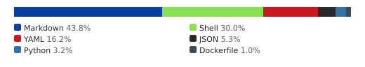
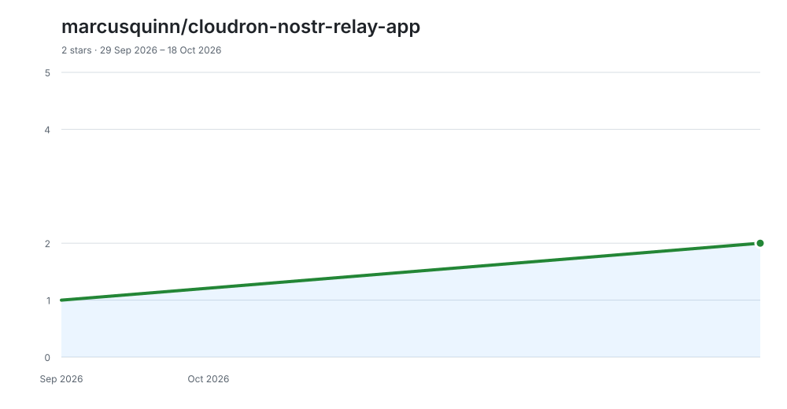

# Private Nostr Relay for Cloudron

<!-- aidevops:badges:start -->
<!-- managed by aidevops badges; edit the template, not this block -->
[](https://github.com/marcusquinn/cloudron-nostr-relay-app/blob/main/LICENSE)
[](https://github.com/marcusquinn/cloudron-nostr-relay-app/releases/latest)

[](docs/metrics/repo-metrics.md)
[](docs/metrics/repo-metrics.md)

[](docs/metrics/repo-metrics.md)
<!-- aidevops:badges:end -->

This package runs [strfry](https://github.com/hoytech/strfry) as a Nostr relay
behind Cloudron TLS. It accepts writes only from public keys listed in the
operator-managed allowlist; an empty allowlist rejects every write.

## Quick start

1. Install the app from Cloudron Community Apps, or with the CLI:

   ```bash
   cloudron install --versions-url https://raw.githubusercontent.com/marcusquinn/cloudron-nostr-relay-app/main/CloudronVersions.json --location relay.example.com
   ```

2. Add writer public keys (`npub` or hexadecimal) to `/app/data/allowlist.txt`
   using the Cloudron File Manager or `cloudron exec`. See
   [Allowlist management](docs/ALLOWLIST.md).
3. Optionally set the relay name and contact shown to clients. See
   [Relay configuration](docs/CONFIGURATION.md).
4. Point Nostr clients at `wss://<app-domain>/`.

Reads are public: anyone with the address can read stored events. The relay
database and allowlist are stored in `/app/data` and included in Cloudron
backup and restore. See the [operator documentation](docs/README.md).

## Development

```bash
cloudron-package-helper.sh validate
bash test/package-test.sh
bash test/relay-smoke.sh
bash test/publish-catalog-test.sh
docker build --platform linux/amd64 -t nostr-relay-smoke:candidate .
bash test/runtime-smoke.sh nostr-relay-smoke:candidate   # needs nak on PATH
```

Publishing is automated on merge to `main`; see
[Publishing](docs/PUBLISHING.md).

<!-- aidevops:managed-readme:start -->
<!-- managed by aidevops; refresh with managed-readme-helper.sh sync -->
## Star History



## Built with aidevops

This project was created and is maintained with
[aidevops.sh](https://aidevops.sh).

[View marcusquinn on GitHub](https://github.com/marcusquinn) ·
[aidevops repository](https://github.com/marcusquinn/aidevops)
<!-- aidevops:managed-readme:end -->
